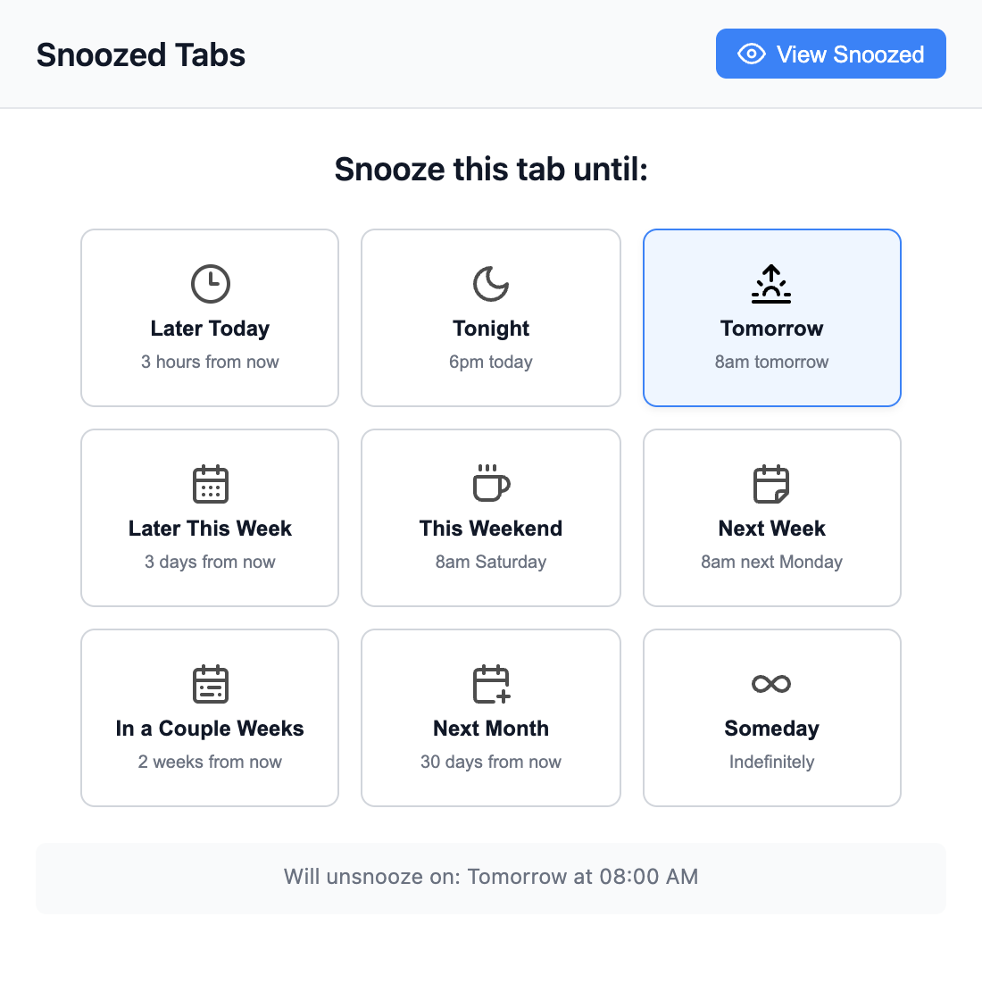
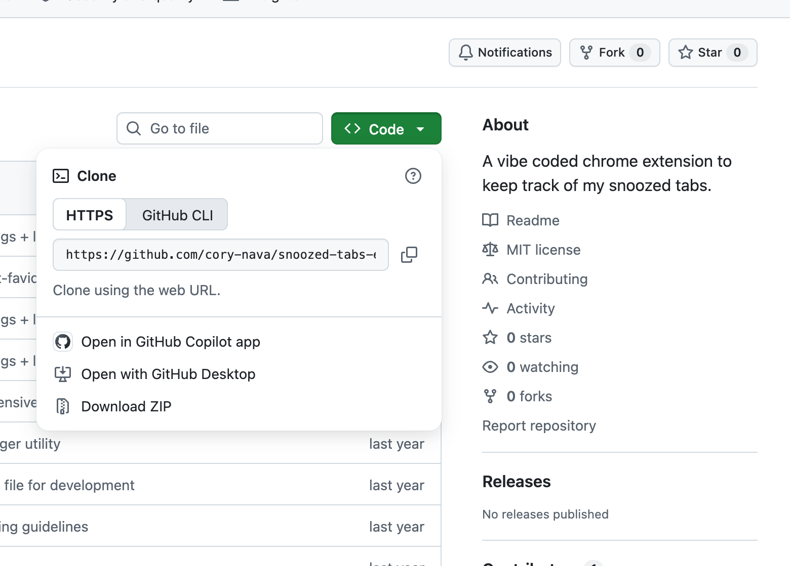
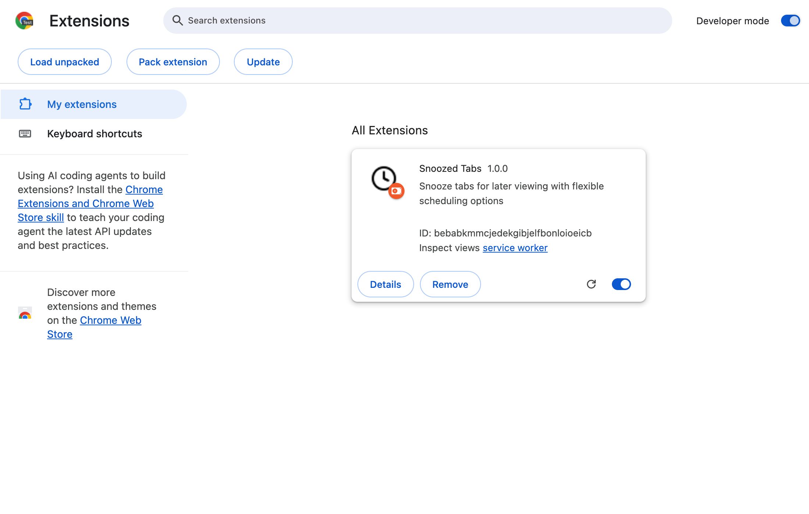
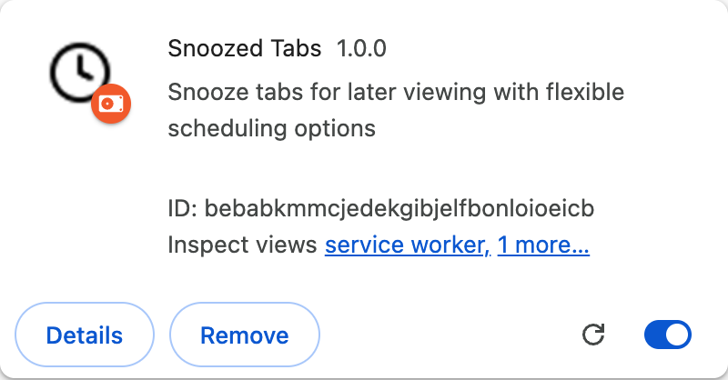
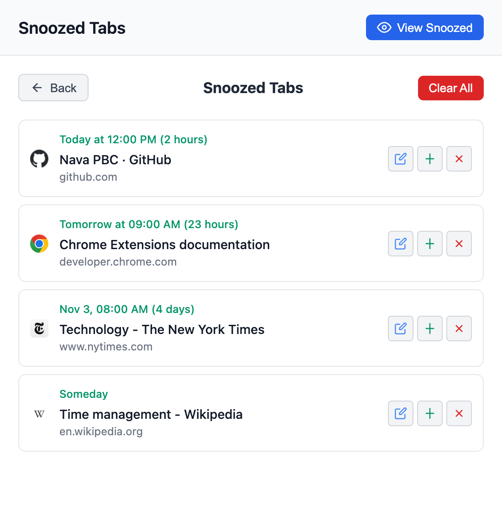

# Snoozed Tabs

A Chrome extension that closes a tab now and brings it back later: tonight, tomorrow morning, next week, or whenever you pick.



## Install (about 5 minutes, no coding needed)

Snoozed Tabs isn't in the Chrome Web Store, so you install it from this repository using Chrome's "Load unpacked" option.

### 1. Download the extension

On this repository's GitHub page, click the green **Code** button, then **Download ZIP**.



Unzip the file. You'll get a folder named `snoozed-tabs-extension-main`.

> **Move that folder somewhere permanent before continuing**, for example `Documents/Chrome Extensions/`. Chrome runs the extension straight from this folder. If you delete the folder or leave it in Downloads and clean that out later, the extension stops working.

If you use git, `git clone https://github.com/cory-nava/snoozed-tabs-extension.git` works too.

### 2. Load it into Chrome

1. Open a new tab and go to `chrome://extensions`.
2. Turn on **Developer mode** (top right).
3. Click **Load unpacked** (top left).
4. Select the folder from step 1, the one that directly contains `manifest.json`, and click **Select**.



Snoozed Tabs now appears in your list of extensions:



### 3. Pin it to your toolbar

Click the puzzle-piece **Extensions** icon to the right of the address bar, then click the pin next to **Snoozed Tabs**. The clock icon now stays in your toolbar.

## Using it

### Snooze a tab

Click the clock icon in the toolbar and pick when you want the tab back. The tab closes right away. Hover over an option to see the exact time it will return.

| Option | Comes back |
| --- | --- |
| Later Today | 3 hours from now |
| Tonight | 6pm today (or 6pm tomorrow if it's already past 6pm) |
| Tomorrow | 8am tomorrow |
| Later This Week | 3 days from now |
| This Weekend | 8am Saturday |
| Next Week | 8am Monday |
| In a Couple Weeks | 2 weeks from now |
| Next Month | 30 days from now |
| Someday | Only when you bring it back yourself |

You can also right-click anywhere on a page and choose **Snooze Tab**.

### See and manage snoozed tabs

Click the clock icon, then **View Snoozed**.



- **Click a tab** or the **+** button to open it now.
- **Pencil** to pick a different time.
- **×** to delete it without opening it.
- **Clear All** to delete everything (it asks first).

When a snoozed tab's time comes, it reopens as a background tab in your current window.

### Good to know

- **Chrome has to be running** for a tab to come back on time. If Chrome was closed, overdue tabs reopen the next time you start it.
- Snoozed tabs are saved in this Chrome profile on this computer only. They don't sync to other machines.
- **Removing the extension deletes your snoozed tabs.** Updating it (below) does not.

## Updating to a new version

1. Download the new ZIP as in step 1.
2. Replace the contents of your existing extension folder with the new files. (Loading the new folder in a different place also works; your snoozed tabs carry over either way.)
3. Go to `chrome://extensions` and click the **reload** arrow (↻) on the Snoozed Tabs card.

## Troubleshooting

**"Manifest file is missing or unreadable"**: you selected the wrong folder. Pick the folder that has `manifest.json` directly inside it. Unzipping sometimes creates a folder inside another folder with the same name.

**The extension disappeared or shows an error after I moved its folder**: Chrome only knows the old location. Click **Remove** on the card, then **Load unpacked** again and select the new location. Your snoozed tabs are kept as long as you load the same extension (it has a fixed ID).

**A tab didn't come back**: check that Chrome was open at the scheduled time. Overdue tabs reopen when Chrome next starts. If one is still missing, go to `chrome://extensions`, click **service worker** on the Snoozed Tabs card, and check the console for errors.

**Something else is wrong**: [open an issue](https://github.com/cory-nava/snoozed-tabs-extension/issues) and include your Chrome version (from `chrome://version`).

## Development

```bash
npm install
npx playwright install chromium   # once, for the end-to-end tests

npm test             # unit tests (Jest)
npm run test:e2e     # loads the real extension into Chromium (Playwright)
npm run lint
npm run screenshots  # regenerates the images in docs/images
```

After changing code, click the reload arrow (↻) on the extension's card in `chrome://extensions`.

### How it works

- `background.js` starts the service worker, and `background/snoozeService.js` does the work. Snoozing saves the tab to `chrome.storage.local`, schedules a `chrome.alarms` alarm, and closes the tab. When the alarm fires, the tab reopens.
- `utils/storage.js` makes every change to the snoozed list one at a time. Chrome can wake the service worker with an alarm at the same moment its startup check finds the same tab overdue. Unsnoozing removes the entry first, and only the caller that removed it opens the tab, so it can't open twice.
- `utils/time.js` calculates snooze times. `popup/` is the toolbar popup.
- The `key` in `manifest.json` gives the extension the same ID wherever it's loaded from, so snoozed tabs survive reinstalling from a new folder.

### Tests

- `tests/background.test.js`: the service worker against an in-memory fake of the `chrome` API (`tests/helpers/fakeChrome.js`), including the overlapping-unsnooze and parallel-write cases.
- `tests/popup.test.js`: the popup in jsdom.
- `tests/time.test.js`: snooze-time math with a frozen clock in UTC.
- `tests/e2e/`: real Chromium, including stopping the service worker so an alarm has to wake it. Set `EXTENSION_DIR=/path/to/other/build` to run the suite against another copy of the extension.

## License

MIT. See [LICENSE](LICENSE).
